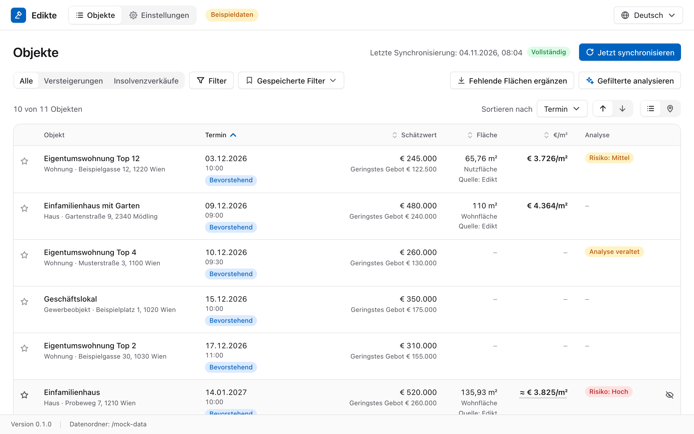
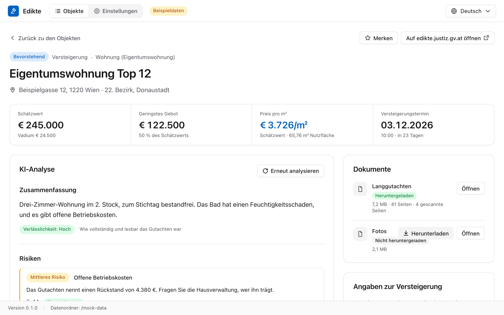
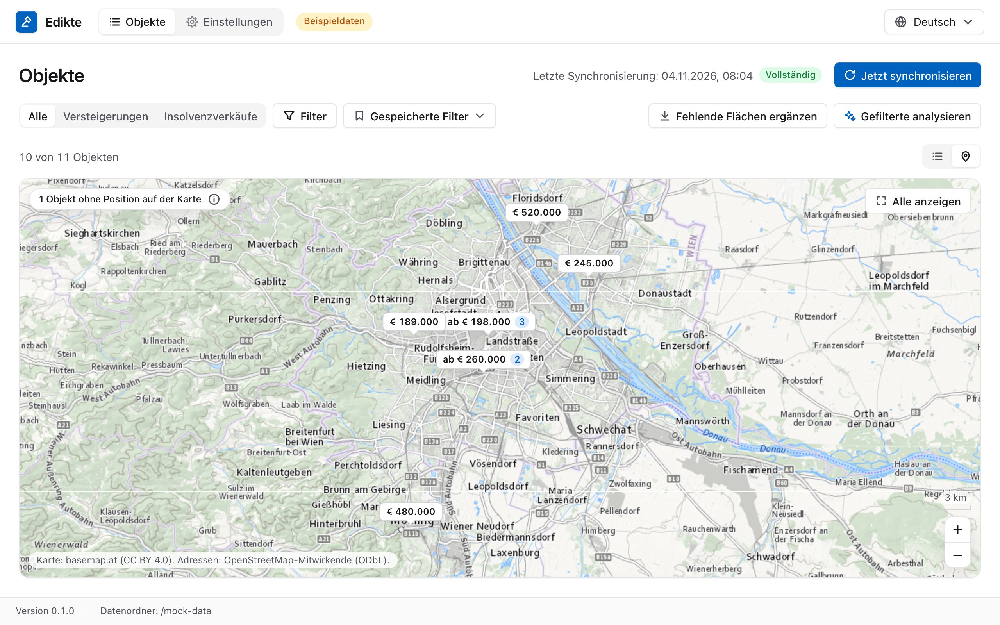
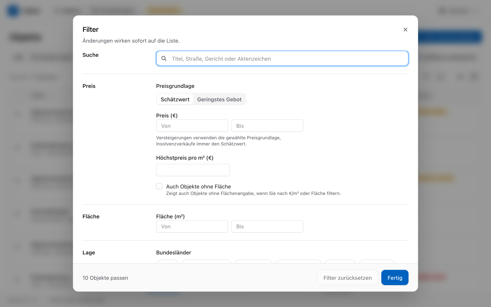
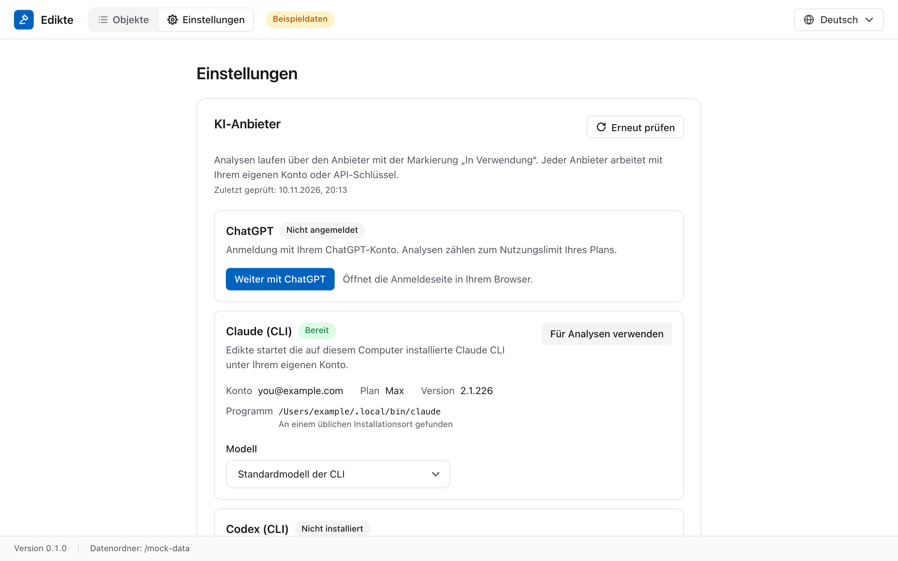
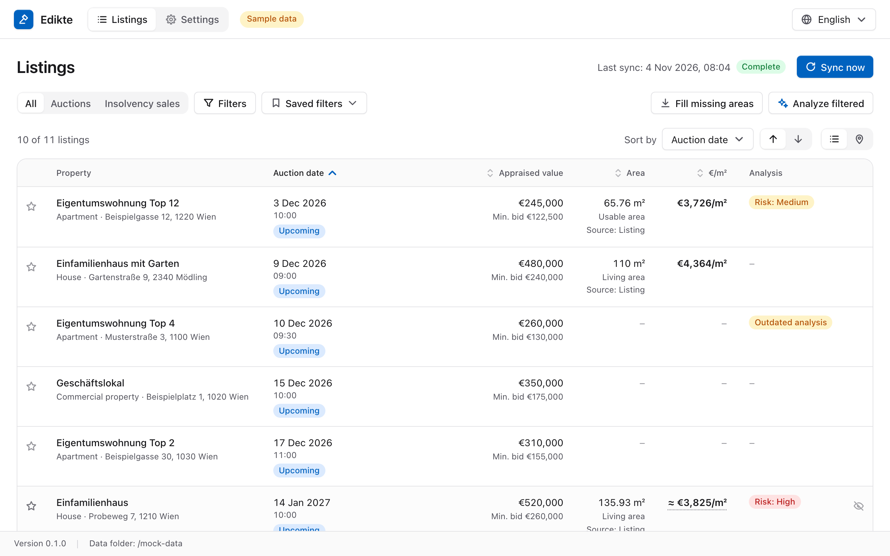
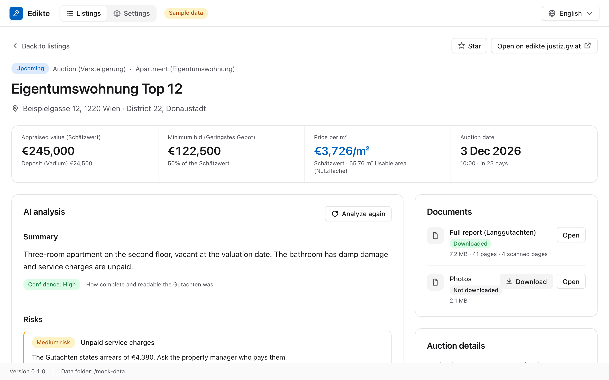
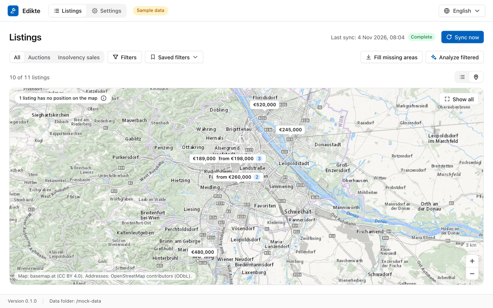
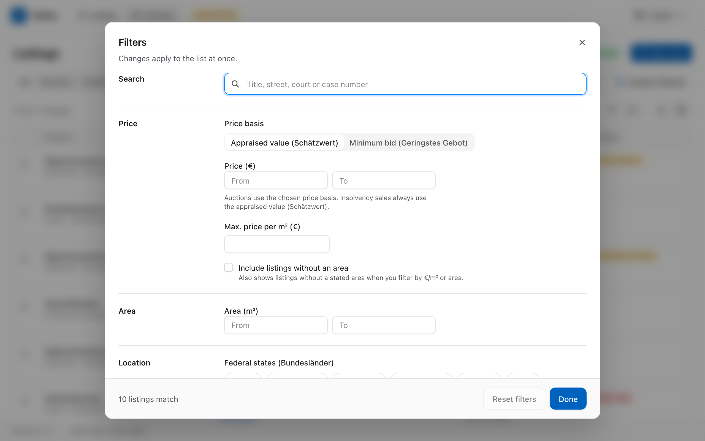
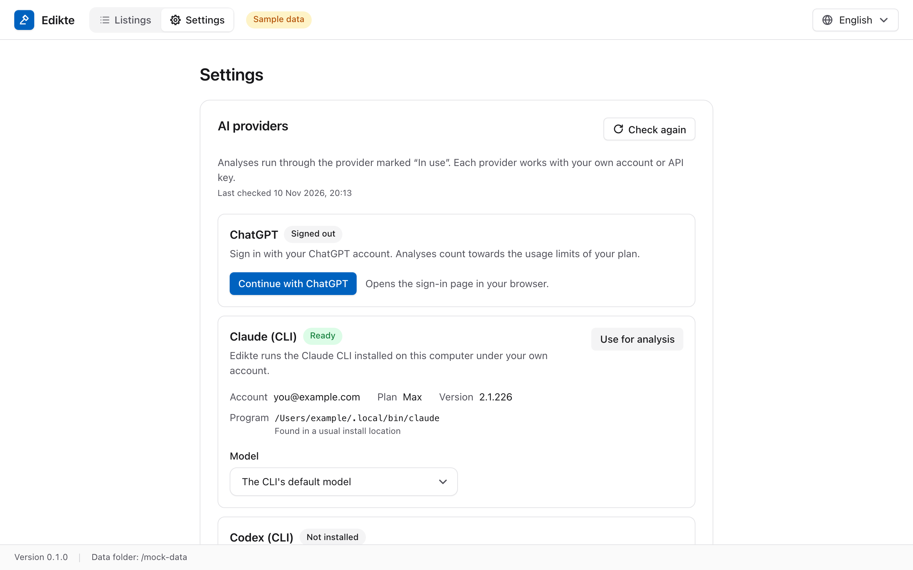

<p align="center">
  
</p>

<h1 align="center">Edikte</h1>

<p align="center">
  Gerichtliche Versteigerungen und Insolvenzverkäufe aus der Ediktsdatei: Preis pro m², Karte und KI-Auswertung der Gutachten.<br>
  Court auctions and insolvency sales from the Austrian Ediktsdatei: price per m², map and AI analysis of the appraisal reports.
</p>

<p align="center">
  <a href="https://github.com/salexandr0s/Edikte/releases/latest"></a>
  <a href="https://github.com/salexandr0s/Edikte/actions/workflows/ci.yml"></a>
</p>

<p align="center"><a href="#deutsch">Deutsch</a> · <a href="#english">English</a></p>

## Deutsch

Edikte ist eine Desktop-App für macOS und Windows. Sie listet gerichtliche Liegenschaftsversteigerungen von edikte.justiz.gv.at und Immobilienangebote aus der Rubrik „Verkäufe und Verpachtungen in Insolvenzverfahren“ auf JustizOnline (justizonline.gv.at). Beide Quellen stehen in einer Liste, die Sie nach dem Preis pro m² filtern können. Gutachten lädt die App bei Bedarf herunter und lässt sie von einem KI-Anbieter auswerten, bei dem Sie sich selbst anmelden.

Die App ist für den privaten Gebrauch gedacht. Sie ist kein Angebot des Bundesministeriums für Justiz und steht in keiner Verbindung zu ihm.

<picture>
  <source media="(prefers-color-scheme: dark)" srcset="docs/screenshots/listings-de-dark.png">
  
</picture>

<p align="center"><sub>Die Bilder zeigen erfundene Beispieldaten aus dem Entwicklungsmodus, keine echten Liegenschaften.</sub></p>

### Funktionen

- **Liste:** Die App lädt die Objekte der gewählten Quellen und Bundesländer, alle sechs Stunden, solange sie geöffnet ist, oder auf Knopfdruck. Beide Quellen sind standardmäßig aktiv und lassen sich in den Einstellungen wählen. Die Quellenwahl über der Liste zeigt alle Objekte, Versteigerungen oder Insolvenzverkäufe. Jede Zeile zeigt Schätzwert, Fläche und Preis pro m², bei Versteigerungen auch das geringste Gebot und den Termin. Insolvenzverkäufe zeigen ihr Veröffentlichungsdatum; sie haben keinen Versteigerungstermin.
- **Filter:** Suche nach Titel, Straße, Gericht oder Aktenzeichen; Preis, Preis pro m², Fläche, Bundesland, Bezirk, Objektart, Status, Versteigerungstermin und Risikostufe. Für Versteigerungen rechnen Preis und Preis pro m² wahlweise mit dem Schätzwert oder dem geringsten Gebot. Für Insolvenzverkäufe gilt immer der Wert aus der Bekanntmachung, in der App als Schätzwert bezeichnet. Filter lassen sich speichern.
- **Karte:** Die Liegenschaften als Preismarken auf der Karte von basemap.at. Die Adressen sucht die App bei Nominatim (OpenStreetMap).
- **Gutachten:** Die App lädt das Gutachten einer Liegenschaft auf Wunsch herunter und liest den Text aus. Fehlende Flächenangaben ergänzt sie aus den Gutachten.
- **KI-Analyse:** Zusammenfassung, Flächen, Verkehrswert mit Stichtag, Zimmer, Stockwerk, Zustand und Heizung, Eigentumsanteil, Mietverhältnis, Lasten, Rückstände, Mängel und Risiken. Bei Insolvenzverkäufen führt die Analyse die im Gutachten genannten Lasten auf und setzt keine Löschung voraus. Zu jeder Angabe gehören, soweit das Gutachten sie hergibt, die Seite und ein Zitat. Die Analyse wird mit der Bekanntmachung abgeglichen, etwa Fläche gegen Objektgröße und Verkehrswert gegen Schätzwert. Auf Wunsch analysiert die App alle gefilterten Liegenschaften auf einmal.
- **Veraltete Ergebnisse:** Passt eine Analyse nicht mehr zum aktuellen Gutachten oder lässt sich die Zuordnung nicht belegen, bleibt sie als veraltet sichtbar. Ihre Werte fließen nicht in Filter, Risikobadges oder den Preis pro m² ein. Eine neue KI-Analyse starten Sie selbst. „Fehlende Flächen ergänzen“ kann gespeicherte Gutachten erneut lokal lesen.
- **Merken und ausblenden:** Liegenschaften lassen sich mit einem Stern markieren oder aus der Liste ausblenden. Objekte mit einem Stern oder Notizen bleiben in der Liste, wenn sie nicht mehr online sind.
- **Zwei Sprachen, zwei Farbschemata:** Deutsch und Englisch; hell oder dunkel nach der Systemeinstellung.

<table>
  <tr>
    <td width="50%" valign="top">
      
      <sub><b>Detail:</b> Kennzahlen, KI-Analyse mit Risiken und die Dokumente der Liegenschaft.</sub>
    </td>
    <td width="50%" valign="top">
      
      <sub><b>Karte:</b> Preismarken auf der Karte von basemap.at, nahe beieinander liegende Objekte gebündelt.</sub>
    </td>
  </tr>
  <tr>
    <td width="50%" valign="top">
      
      <sub><b>Filter:</b> Änderungen wirken sofort auf die Liste.</sub>
    </td>
    <td width="50%" valign="top">
      
      <sub><b>Einstellungen:</b> KI-Anbieter mit Konto, Modell und Programmpfad.</sub>
    </td>
  </tr>
</table>

### Installation

Die Dateien finden Sie unter „Releases“ auf der GitHub-Seite dieses Projekts. Wählen Sie die Datei, die zu Ihrem Computer passt:

| Computer                           | Datei                                |
| ---------------------------------- | ------------------------------------ |
| Mac mit Apple-Chip (M1 oder neuer) | `Edikte-<Version>-mac-arm64.dmg`     |
| Mac mit Intel-Prozessor            | `Edikte-<Version>-mac-x64.dmg`       |
| Windows, 64 Bit                    | `Edikte-<Version>-win-x64-setup.exe` |

Welchen Chip Ihr Mac hat, steht im Apple-Menü unter „Über diesen Mac“. Die `.zip`-Dateien enthalten dieselbe Mac-App, nur ohne Disk-Image.

- macOS: Öffnen Sie die `.dmg`-Datei und ziehen Sie Edikte in den Ordner „Programme“.
- Windows: Starten Sie die `setup.exe`. Sie installiert Edikte ohne Administratorrechte nur für Ihr Benutzerkonto in `%LOCALAPPDATA%\Programs\edikte`, legt Verknüpfungen im Startmenü und auf dem Desktop an und startet die App.

`SHA256SUMS.txt` enthält die SHA-256-Prüfsummen aller Dateien eines Releases. Auf dem Mac berechnen Sie die Prüfsumme im Terminal mit `shasum -a 256 <Datei>`, unter Windows in der PowerShell mit `Get-FileHash <Datei>`.

### Nicht signierte App öffnen

Die Builds sind nicht mit einem Entwicklerzertifikat signiert. Deshalb müssen Sie die App beim ersten Start einmal ausdrücklich zulassen.

macOS:

1. Öffnen Sie Edikte. macOS meldet, dass die App nicht geöffnet wurde. Klicken Sie auf „Fertig“.
2. Öffnen Sie „Systemeinstellungen“ > „Datenschutz & Sicherheit“ und scrollen Sie nach unten zu „Sicherheit“.
3. Klicken Sie bei der Meldung zu Edikte auf „Dennoch öffnen“ und bestätigen Sie mit Ihrem Passwort oder mit Touch ID.
4. Klicken Sie im nächsten Fenster noch einmal auf „Dennoch öffnen“.

Danach startet Edikte ohne diese Abfrage. Nach dem Download einer neuen Version kann sie wieder erscheinen.

Windows: SmartScreen meldet „Der Computer wurde durch Windows geschützt“. Klicken Sie auf „Weitere Informationen“ und dann auf „Trotzdem ausführen“.

### KI-Anbieter verbinden

Für die Auswertung der Gutachten verbinden Sie Edikte in den Einstellungen mit einem dieser Anbieter:

| Verbindung              | Was Sie brauchen                                                |
| ----------------------- | --------------------------------------------------------------- |
| Anmeldung mit ChatGPT   | ein ChatGPT-Konto                                               |
| Claude-Kommandozeile    | das Programm `claude` von Anthropic, installiert und angemeldet |
| Codex-Kommandozeile     | das Programm `codex` von OpenAI, installiert und angemeldet     |
| OpenAI-API-Schlüssel    | einen API-Schlüssel aus Ihrem OpenAI-Konto                      |
| Anthropic-API-Schlüssel | einen API-Schlüssel aus Ihrem Anthropic-Konto                   |

- Bei den Kommandozeilen startet Edikte Ihr eigenes Programm, das unter Ihrem Konto läuft. Die Anmeldedaten dieser Programme liest Edikte nicht. Findet Edikte ein Programm nicht, wählen Sie seine Datei in den Einstellungen aus.
- Die ChatGPT-Anmeldung und API-Schlüssel speichert Edikte verschlüsselt im Datenordner, auf dem Mac mit einem Schlüssel aus dem Schlüsselbund, unter Windows mit der Datenverschlüsselung von Windows (DPAPI). Umgebungsvariablen wie `OPENAI_API_KEY` oder `ANTHROPIC_API_KEY` liest Edikte nicht.
- Mit einem API-Schlüssel rechnet der Anbieter die Analysen nach Verbrauch über Ihr Konto ab.
- Edikte ist nicht Claude Code und kein Produkt von Anthropic oder OpenAI.

### Datenordner

Edikte speichert alle Daten in einem Ordner:

- macOS: `~/Library/Application Support/Edikte`
- Windows: `%APPDATA%\Edikte`

Darin liegen die Datenbank (`edikte.sqlite`), die heruntergeladenen Gutachten (`documents`), die Kartenkacheln (`tiles`) und die verschlüsselten Anmeldedaten (`secrets.json`). Den genauen Pfad zeigt das App-Fenster nach „Datenordner:“ an. Heruntergeladene Gutachten löscht die App, sobald ein Verfahren länger als die eingestellte Frist abgeschlossen ist, standardmäßig 90 Tage.

Vor einer anstehenden Datenbankmigration legt Edikte eine konsistente Sicherung im Unterordner `migration-backups` an. Schlägt die Sicherung fehl, wird die Datenbank nicht aktualisiert. Sicherungen bleiben erhalten, bis Sie sie selbst entfernen.

Um alle Daten zu löschen, beenden Sie Edikte und löschen den Ordner. Auf dem Mac bleibt danach im Schlüsselbund ein Eintrag „Edikte Safe Storage“, den Sie in der Schlüsselbundverwaltung löschen können. Unter Windows deinstallieren Sie die App unter „Einstellungen“ > „Apps“ > „Installierte Apps“. Der Datenordner bleibt dabei erhalten.

### Datenschutz

- Edikte ruft die öffentlichen Versteigerungsseiten auf edikte.justiz.gv.at und die JSON-Schnittstelle hinter der öffentlichen Suche auf justizonline.gv.at ab, insgesamt höchstens eine Anfrage pro Sekunde.
- Die Schuldnerfelder aus Insolvenzbekanntmachungen werden nicht gespeichert. Die Kontaktdaten der Insolvenzverwaltung und ihrer Stellvertretung sowie die Beschreibung des Objekts stehen in der Detailansicht.
- Für die Karte sendet Edikte die Adressen der geladenen Liegenschaften je einmal an Nominatim (nominatim.openstreetmap.org) und speichert die Antworten in der Datenbank. Die Kartenkacheln lädt die App von basemap.at und behält sie 14 Tage im Datenordner.
- Gutachten nennen die Eigentümer und enthalten Daten aus dem Grundbuch. Die heruntergeladenen Dateien bleiben im Datenordner auf Ihrem Computer.
- Der Text eines Gutachtens geht erst an Ihren KI-Anbieter, wenn Sie eine Analyse starten. Vor der ersten Analyse fragt Edikte, ob Sie damit einverstanden sind. Für die Verarbeitung beim Anbieter gelten dessen Bedingungen.

### Entwicklung

Sie brauchen Node.js 24 oder neuer.

```sh
npm ci                # Abhängigkeiten installieren
npm run dev           # App mit Hot Reload
npm run dev:renderer  # nur die Oberfläche im Browser, mit erfundenen Beispieldaten
npm run typecheck     # TypeScript
npm run lint          # ESLint
npm run format:check  # Prettier
npm test              # Unit-Tests (Vitest)
npm run test:e2e      # baut die App und startet den Playwright-Smoke-Test
npm run icons         # rendert build/icon.icns, .ico und .png aus build/icon.svg
npm run screenshots   # erneuert die Bilder in docs/screenshots, während dev:renderer läuft
npm run dist:mac      # Mac-Pakete für die Architektur dieses Macs, in dist/
npm run dist:win      # Windows-Installer, in dist/
```

Mit `EDIKTE_OFFLINE=1 npm run dev` startet die App ohne automatische Aktualisierung, und die Erkennung der KI-Anbieter startet keine Befehlszeilenprogramme. Tests gegen die echte Website laufen nur mit `EDIKTE_LIVE=1`.

Die Bilder in dieser Datei entstehen mit `npm run screenshots`, während `npm run dev:renderer` läuft. Das Skript braucht das Chromium von Playwright (`npx playwright install chromium`) und fotografiert jede Ansicht auf Deutsch und auf Englisch, die Liste auch im dunklen Farbschema.

Ein gebautes Paket prüfen Sie mit dem Selbsttest. Er startet die App mit einem leeren, temporären Datenordner und endet mit Exit-Code 0, wenn die Oberfläche ihre Daten vom Hauptprozess bekommen hat:

```sh
node scripts/run-self-check.mjs dist/mac-arm64/Edikte.app/Contents/MacOS/Edikte
```

Für ein Release erhöhen Sie die Version und pushen den Tag:

```sh
npm version 0.2.0 -m "chore(release): %s"
git push --follow-tags
```

Der Workflow „Release“ baut die Pakete für macOS (arm64 und x64) und Windows (x64), prüft jedes Paket mit dem Selbsttest und legt einen Release-Entwurf mit `SHA256SUMS.txt` an. Den Entwurf veröffentlichen Sie danach selbst auf GitHub. Ein manueller Lauf über „Run workflow“ baut die Pakete ohne Release. Sie bleiben 14 Tage als Artefakte des Laufs erhalten.

Die Regeln für Code, Daten und Tests stehen in [CLAUDE.md](CLAUDE.md).

### Lizenz

Dieses Projekt hat noch keine Lizenz. Solange keine Lizenzdatei vorliegt, gilt das gewöhnliche Urheberrecht.

## English

Edikte is a desktop app for macOS and Windows. It lists court property auctions from the Austrian edicts database (Ediktsdatei, edikte.justiz.gv.at) and real-estate sales and leases in insolvency proceedings from JustizOnline (justizonline.gv.at). Both sources share a list that you can filter by price per m². It downloads appraisal reports (Gutachten) on demand and has them analysed by an AI provider that you sign in to yourself.

The app is meant for personal use. It is not a service of the Austrian Federal Ministry of Justice (Bundesministerium für Justiz) and has no connection to it.

<picture>
  <source media="(prefers-color-scheme: dark)" srcset="docs/screenshots/listings-en-dark.png">
  
</picture>

<p align="center"><sub>The screenshots show made-up sample data from the development mode, not real properties.</sub></p>

### Features

- **List:** The app loads the listings of the chosen sources and Bundesländer, every six hours while it is open or when you press Sync. Both sources are enabled by default and can be chosen in Settings. The source switch above the list shows all listings, auctions or insolvency sales. Each row shows the appraised value (Schätzwert), area and price per m²; auctions also show the minimum bid (geringstes Gebot) and date. Insolvency sales show their publication date and have no auction date.
- **Filters:** Search by title, street, court or case number; price, price per m², area, Bundesland, district, property type, status, auction date and risk level. For auctions, price and price per m² use either the appraised value or the minimum bid. For insolvency sales, they always use the value from the notice, labelled appraised value in the app. Filters can be saved.
- **Map:** The properties as price markers on the basemap.at map. The app looks up the addresses at Nominatim (OpenStreetMap).
- **Appraisal reports:** The app downloads the report of a property when you ask for it and extracts the text. Where a listing states no area, it takes the area from the report.
- **AI analysis:** Summary, areas, market value (Verkehrswert) with valuation date, rooms, floor, condition and heating, ownership share, tenancy, encumbrances, arrears, defects and risks. For insolvency sales, the analysis lists the encumbrances named in the report without assuming that they are deleted. Each value comes with the page and a quote from the report, where the report provides them. The analysis is checked against the notice, for example area against the listed size and market value against the appraised value. You can also analyse every filtered property at once.
- **Outdated results:** An analysis that no longer matches the current report, or whose match cannot be verified, stays visible as outdated. Its values do not feed filters, risk badges or price per m². You choose when to start another AI analysis. “Fill missing areas” can read saved reports again locally.
- **Star and hide:** Properties can be starred or hidden from the list. Listings with a star or notes remain in the list after they leave the site.
- **Two languages, two colour schemes:** German and English; light or dark following the system setting.

<table>
  <tr>
    <td width="50%" valign="top">
      
      <sub><b>Detail:</b> key figures, the AI analysis with its risks, and the property's documents.</sub>
    </td>
    <td width="50%" valign="top">
      
      <sub><b>Map:</b> price markers on the basemap.at map, with nearby properties grouped.</sub>
    </td>
  </tr>
  <tr>
    <td width="50%" valign="top">
      
      <sub><b>Filters:</b> changes apply to the list at once.</sub>
    </td>
    <td width="50%" valign="top">
      
      <sub><b>Settings:</b> AI providers with account, model and program path.</sub>
    </td>
  </tr>
</table>

### Installation

The files are under "Releases" on this project's GitHub page. Pick the file for your computer:

| Computer                             | File                                 |
| ------------------------------------ | ------------------------------------ |
| Mac with Apple silicon (M1 or later) | `Edikte-<version>-mac-arm64.dmg`     |
| Mac with an Intel processor          | `Edikte-<version>-mac-x64.dmg`       |
| Windows, 64-bit                      | `Edikte-<version>-win-x64-setup.exe` |

To see which chip your Mac has, choose "About This Mac" from the Apple menu. The `.zip` files contain the same Mac app without a disk image.

- macOS: Open the `.dmg` file and drag Edikte into the Applications folder.
- Windows: Run the `setup.exe`. It installs Edikte for your user account only, without administrator rights, into `%LOCALAPPDATA%\Programs\edikte`, adds shortcuts to the Start menu and the desktop, and starts the app.

`SHA256SUMS.txt` lists the SHA-256 checksums of all files in a release. On a Mac, compute a checksum in Terminal with `shasum -a 256 <file>`. On Windows, use `Get-FileHash <file>` in PowerShell.

### Opening the unsigned app

The builds are not signed with a developer certificate, so you have to allow the app once when you first start it.

macOS:

1. Open Edikte. macOS reports that the app was not opened. Click "Done".
2. Open "System Settings" > "Privacy & Security" and scroll down to "Security".
3. Next to the message about Edikte, click "Open Anyway" and confirm with your password or Touch ID.
4. In the next window, click "Open Anyway" again.

After that, Edikte starts without asking. The prompt can come back after you download a new version.

Windows: SmartScreen shows "Windows protected your PC". Click "More info", then "Run anyway".

### Connecting an AI provider

To analyse appraisal reports, connect Edikte to one of these providers in Settings:

| Connection           | What you need                                                |
| -------------------- | ------------------------------------------------------------ |
| Sign in with ChatGPT | a ChatGPT account                                            |
| Claude command line  | the `claude` program from Anthropic, installed and signed in |
| Codex command line   | the `codex` program from OpenAI, installed and signed in     |
| OpenAI API key       | an API key from your OpenAI account                          |
| Anthropic API key    | an API key from your Anthropic account                       |

- With a command-line tool, Edikte starts your own program, which runs under your account. Edikte does not read the sign-in data of these programs. If Edikte cannot find a program, choose its file in Settings.
- Edikte stores the ChatGPT sign-in and API keys encrypted in the data folder, on a Mac with a key from the keychain, on Windows with Windows data protection (DPAPI). Edikte does not read environment variables such as `OPENAI_API_KEY` or `ANTHROPIC_API_KEY`.
- With an API key, the provider bills the analyses to your account by usage.
- Edikte is not Claude Code and is not a product of Anthropic or OpenAI.

### Data folder

Edikte keeps all its data in one folder:

- macOS: `~/Library/Application Support/Edikte`
- Windows: `%APPDATA%\Edikte`

It holds the database (`edikte.sqlite`), the downloaded appraisal reports (`documents`), the map tiles (`tiles`) and the encrypted sign-in data (`secrets.json`). The app window shows the exact path after "Data folder:". The app deletes a downloaded report once its case has been closed for longer than the retention setting, 90 days by default.

Before a pending database migration, Edikte saves a consistent backup in the `migration-backups` subfolder. If the backup fails, the database is not upgraded. Backups remain until you remove them.

To delete all data, quit Edikte and delete the folder. On a Mac, a keychain item named "Edikte Safe Storage" remains, which you can delete in Keychain Access. On Windows, uninstall the app under "Settings" > "Apps" > "Installed apps". This keeps the data folder.

### Privacy

- Edikte fetches the public auction pages on edikte.justiz.gv.at and the JSON API behind the public search on justizonline.gv.at, at most one request per second across both hosts.
- Debtor fields from insolvency notices are not stored. The detail view shows the administrator's and deputy's contact details and the property description.
- For the map, Edikte sends the address of each loaded property once to Nominatim (nominatim.openstreetmap.org) and stores the answers in the database. It fetches the map tiles from basemap.at and keeps them in the data folder for 14 days.
- Appraisal reports name the owners and contain land register (Grundbuch) data. The downloaded files stay in the data folder on your computer.
- The text of a report goes to your AI provider only when you start an analysis. Before the first analysis, Edikte asks for your consent. The provider's own terms apply to how it processes the text.

### Development

You need Node.js 24 or later.

```sh
npm ci                # install dependencies
npm run dev           # app with hot reload
npm run dev:renderer  # interface only, in a browser, with made-up sample data
npm run typecheck     # TypeScript
npm run lint          # ESLint
npm run format:check  # Prettier
npm test              # unit tests (Vitest)
npm run test:e2e      # builds the app and runs the Playwright smoke test
npm run icons         # renders build/icon.icns, .ico and .png from build/icon.svg
npm run screenshots   # refreshes the images in docs/screenshots while dev:renderer runs
npm run dist:mac      # Mac packages for this Mac's architecture, in dist/
npm run dist:win      # Windows installer, in dist/
```

With `EDIKTE_OFFLINE=1 npm run dev`, the app starts without its automatic sync, and provider detection starts no command-line tools. Tests against the live site run only with `EDIKTE_LIVE=1`.

The images in this file come from `npm run screenshots`, run while `npm run dev:renderer` is up. The script needs Playwright's Chromium (`npx playwright install chromium`) and captures every screen in German and in English, the list in the dark colour scheme as well.

The self-check tests a packaged build. It starts the app with an empty temporary data folder and exits with code 0 when the interface received its data from the main process:

```sh
node scripts/run-self-check.mjs dist/mac-arm64/Edikte.app/Contents/MacOS/Edikte
```

To release, raise the version and push the tag:

```sh
npm version 0.2.0 -m "chore(release): %s"
git push --follow-tags
```

The Release workflow builds the packages for macOS (arm64 and x64) and Windows (x64), runs the self-check on each package and creates a draft release with `SHA256SUMS.txt`. You publish the draft on GitHub yourself. A manual run with "Run workflow" builds the packages without a release and keeps them as run artifacts for 14 days.

The rules for code, data and tests are in [CLAUDE.md](CLAUDE.md).

### Licence

This project has no licence yet. Until a licence file is added, ordinary copyright applies.
